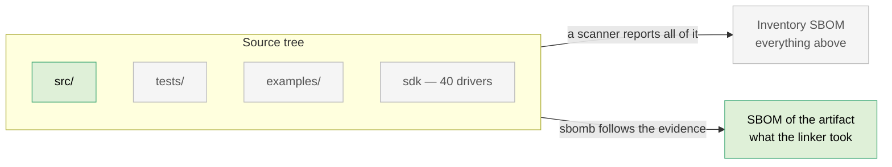
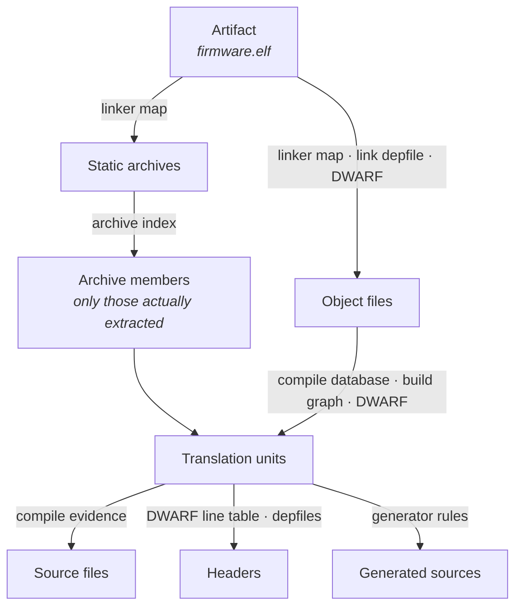
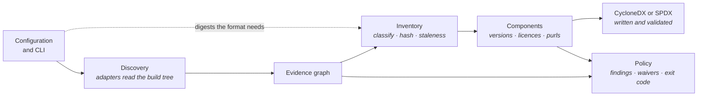
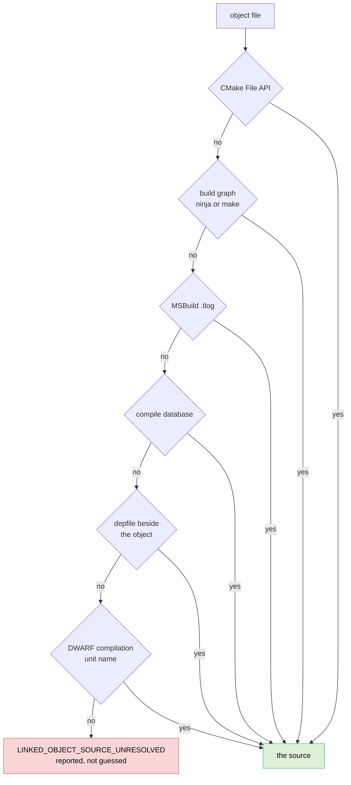
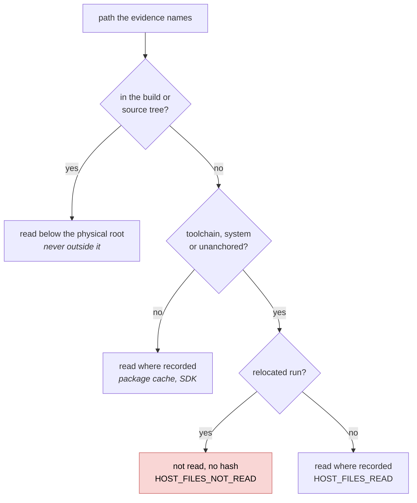
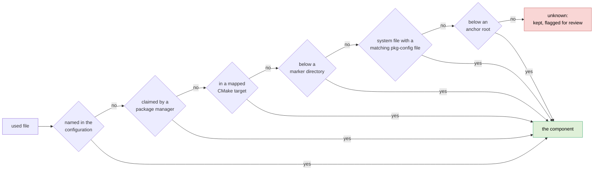
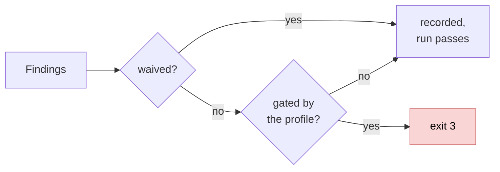
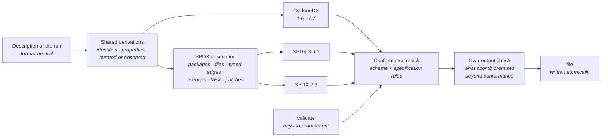

# How sbomb works

sbomb answers one question:

> Which files and components demonstrably reached *this* build artifact?

Everything else follows from that. This document explains the machinery — what
evidence sbomb reads, how it turns that into a chain, and where it refuses to
guess. It is written for someone who has to trust the output, not for someone
editing the code.

## The rule everything rests on

A file enters the SBOM only if there is an unbroken chain of evidence from it to
a final deliverable. Presence on disk is not evidence. Neither is a plausible
name, a nearby directory, or a mention in a manifest.

That single rule is why sbomb produces a different — usually much smaller —
answer than a repository scanner. Your source tree contains tests, examples,
vendored SDKs, three architectures' worth of drivers and a package-manager
cache. Your firmware image contains a fraction of it. sbomb describes the
image.



## The chain

The chain runs backwards from the deliverable. Each step is a different kind of
evidence, produced by a different part of the build, read by a different
adapter.



The distinction that does the most work is **archives**. A static library on
the link line contributes only the members the linker actually pulled in. A
scanner reports the whole library; sbomb reports the members named in the map.

## The stages of a run



Discovery is the only stage that reads build metadata. Later stages still touch
the tree — inventory hashes the files that survived and checks whether the build
is stale, and component mapping looks for a manifest or licence file at a
component's root — but none of them adds anything to the graph. What belongs in
the document was settled before they ran, which is why the same evidence always
produces the same document.

The format is chosen with the configuration, before discovery, and the one
thing it may ask of an earlier stage is an extra digest of the bytes inventory
already reads. It is asked before any file is read and handed down as the names
of digest algorithms, so no stage learns which format asked and no file is read
twice. SPDX 2.3 is the one format that asks: it requires a SHA-1 of every file,
beside the SHA-256 every run computes.

## What sbomb reads

| Source | What it settles |
|---|---|
| CMake File API | Targets, artifacts, source lists, toolchain and sysroot locations |
| `compile_commands.json` | Which source produced which object, and with which flags |
| Linker map (`-Wl,-Map=` or MSVC `/MAP:`) | What the linker put into the artifact, including archive members |
| Link dependency file (`-Wl,--dependency-file=`) | The link inputs, as the linker itself listed them |
| DWARF debug information | The translation units in the binary, and the headers each one used |
| `build.ninja` / `.ninja_deps` | Object↔source edges and the headers each compile read |
| Makefiles (`build.make`, `*.o.d`) | The same, for the Makefiles generator |
| MSBuild `.tlog` files | Object↔source mappings, header dependencies and archive/link inputs from Visual Studio builds |
| MSVC build log (`/VERBOSE:REF`) | Linker-discarded object evidence when preserved as `build.log` |
| Response files | Link and compile lines too long for a command line |
| Package manifests | Component identity for vcpkg, Conan, FetchContent, git submodules |
| Package file lists | Which installed files belong to which package, where the manager wrote it down |
| Bundled SBOMs | What a dependency says about itself, where it ships a CycloneDX or SPDX document |
| Distribution image manifests | Name, version and licence for a component the evidence chain already reached, where a Yocto or Buildroot build wrote one |
| Packaging manifests (sbomb's native manifest, CMake `install_manifest.txt`) | Which assets, data files and binaries an image or package contains — inputs no compiler or linker sees |

Some of these are not there unless you ask the build to produce them. The
linker map and link dependency file are produced by linker flags, which is what
the CMake integration adds. MSVC uses `/MAP:` and `/VERBOSE:REF`; Visual Studio
builds additionally leave the structured `.tlog` evidence that the MSBuild
adapter reads. A missing optional evidence source degrades to the next
strategy and is reported as a finding rather than being silently replaced by a
guess.

An image is a deliverable built from other files: the firmware, a filesystem,
certificates, a partition table. A packaging manifest that names a file as an
input of an output is evidence for that file; a file lying next to the output is
not. An output counts only when a deliverable reaches it — it is the deliverable,
or an input of an output that is reached. A manifest describing an image no
deliverable reaches adds nothing to the document. It is reported as
`PACKAGING_OUTPUT_NOT_DELIVERED`, with how to declare the image as a
deliverable.

## Resolving an object to its source

There is never one way to learn which source produced `main.c.o`, and the
tempting way — matching basenames — is wrong. Two targets routinely compile
different files with the same name. sbomb tries the authoritative sources
first and stops at the first that gives exactly one answer:



When two strategies disagree, the higher-priority one wins and the
disagreement is reported rather than hidden. The finding names what each
strategy said and which one was used, so that a reviewer can look at the loser
instead of only learning that one existed. It is informational: a second answer
is something to look at, not a reason to trust the winner less.

## Headers

Headers are where most SBOM tools quietly overstate. An `#include` that the
preprocessor skipped inside an `#ifdef` did not contribute anything, and a
dependency file lists it anyway, because a dependency file exists to trigger
rebuilds — being generous is correct for that job and wrong for this one.

sbomb prefers the **DWARF line table**, which lists the files that actually
emitted code or declarations into the compilation unit. Dependency files are
the fallback for translation units with no debug information. MSVC
`/showIncludes` output reaches the same dependency evidence through Ninja or
MSBuild TLogs. Which of the available sources governs is a policy choice:

| `--header-evidence` | Behaviour |
|---|---|
| `dwarf-preferred` *(default)* | DWARF where available, dependency files elsewhere |
| `union` | Everything either source names — the conservative reading |
| `depfiles` | Dependency files only |

Every header is then classified into exactly one class — project, third party,
SDK, generated, compiler runtime, system, or unknown — because a compliance
document treats a vendored crypto header differently from `stddef.h`. The
classification uses the include directories the toolchain itself reports, not a
hardcoded list of paths, and what each class does is a policy setting.

## Identity: anchors

An SBOM full of `/home/jenkins/workspace/build-472/src/main.c` is neither
portable nor comparable between two machines. Every file identity in sbomb is
an **anchor plus a relative path**:

```
project:src/main.c
build:generated/version.h
sdk:espidf:components/esp_wifi/src/wifi.c
pkg:conan/mbedtls:include/mbedtls/aes.h
```

The project root, build root, toolchain and sysroot are anchored automatically
from what the build itself reports. Anything else is anchored in the
configuration. A file under no anchor keeps its absolute path, is reported as
`UNANCHORED_FILE`, and can be replaced by a digest with
`--redact-unanchored-paths` — the same substitution in the SBOM, the findings
and the review report.

Anchoring is also what makes the output reproducible across machines: two
builds of the same commit in different directories produce byte-identical
documents.

A path is read in the spelling the build wrote it in, not by the rules of the
host sbomb runs on. A POSIX path stays a POSIX path on a Windows host, a UNC
path such as `\\server\share\a.obj` is absolute on every host, and a relative
path is relative to the build directory. Under Windows path rules names compare
without case, and a file the evidence names in another case is found in its
spelling on disk. The same build directory gives the same document on Linux and
on Windows.

## Where the build ran

The SBOM is often generated somewhere other than where the build ran: one CI
job builds, a second restores the build directory and runs sbomb. The evidence
records the paths of the build machine. The build tree and the source tree
therefore each have two roots: the **logical** root the evidence records, and
the **physical** root sbomb reads from, `--build-dir` and `--source-dir`.

Identity uses the logical roots only. Moving a tree changes no identity in the
document — not even an anchor root an adapter found by reading the moved tree.
Reads use the physical roots, and a moved read stays inside them: a path that
would leave the physical source root is not read and has no hash. A physical
source tree that does not exist is reported once, as
`SOURCE_TREE_UNAVAILABLE`, and the hashes and licences that needed it are
reported missing. Without a CMake File API reply there is no logical source
root, and the source tree is not relocated.

A file outside both trees that the evidence names by absolute path is a file of
the machine that built. If it is a toolchain or system file, or anchors nowhere,
the file of that name on this host need not be the same file. A **relocated**
run — the build tree or the source tree is read from another directory than the
evidence records — therefore does not read it: no hash, no debug information,
nothing attributed from its content. Where it lies still classifies it. The run
says so once, as `HOST_FILES_NOT_READ`. A run on the machine that built reads
these files and notes it once, as `HOST_FILES_READ`. A package cache or an SDK
is read where the build recorded it, relocated or not.



## Confidence

Not every edge is equally strong, and the document says which is which. Two
things decide it: how direct the evidence is, and what kind of source it came
from.

| Strength | Structured, authoritative | Structured, secondary | Textual fallback |
|---|---|---|---|
| **direct** — the source states it outright | high | high | medium |
| **linked** — the linker recorded it | high | medium | low |
| **derived** — read off a mapping | high | medium | low |
| **packaged** — a package manager recorded it | high | medium | low |
| **generated** — produced by a build rule | medium | medium | low |
| **weak** — a last-resort strategy | low | low | low |

A linker map is authoritative about linking; a build log is a textual fallback.

Confidence is then **downgraded** for the two things that blur attribution after
the evidence was recorded: link-time optimization, which lets the compiler move
code between translation units, and section garbage collection, which drops
parts of an object the linker found nothing needed. Each downgrade is recorded
with its reason, so a low-confidence edge always says why.

A unity build is not a downgrade. Several sources are fused into one translation
unit before anything is recorded, so the evidence was never precise to begin
with; those edges simply start lower.

## Components and licences

Files are grouped into components in a fixed priority order. The first strategy
that answers wins, and each one is a stronger statement than the one below it.



A package manager claims a file in one of two ways. If it wrote down which files
it installed, that list is read and the file is looked up in it — exact, and the
only thing that works for a manager that merges every package into one shared
tree. Otherwise the file has to lie below one of the package's roots. A package
has more than one: the checkout it was fetched into and the directory the build
generated for it are both its own.

Where those roots are is knowledge each adapter carries, not something anybody
searches for: `_deps/<name>-src` for FetchContent, the triplet tree for vcpkg,
`managed_components/<namespace>__<name>` for the ESP-IDF component manager.
An adapter opens the paths it names and no others, which is why reading a
build tree never turns into a walk of somebody's source tree.

A **marker directory** is one carrying a package manifest — a conanfile, a
`vcpkg.json`, an `idf_component.yml`, a `Cargo.toml` — a licence file, or a
bundled SBOM under a conventional name (`sbom.cdx.json`, `bom.spdx.json`,
`sbom.yml` and their siblings). The licence file is the weakest of these and
the most useful: a library that was copied into the source tree usually has
nothing else to identify it. The search walks up from the file and stops at the
anchor root, so your own top-level licence — and your own SBOM — can never be
mistaken for a dependency's.

A toolchain or system file below no marker can still be named. Where the
distribution installed a pkg-config file that verifies against it, the file's
component is named after that module and takes the version the file states,
instead of folding into one component named after the sysroot. It remains a
system component and stays out of the product's dependencies.

Once a component is known, whatever the package wrote about itself is read.
Several files may say something, and they disagree often enough that the order
matters. One rule settles it: **installed beats declared, and a dependency's own
SBOM beats both.** A manifest says what somebody wanted; an install record says
what is there.

| Rank | Source | Typically states |
|---|---|---|
| above all | Your configuration | whatever you set |
| 1 | An SBOM the dependency ships | version, licence, supplier, purl |
| 2 | What the manager recorded while installing | version, licence, supplier, purl, file list |
| 3 | The manifest that manager declares | version, licence, supplier |
| 4 | Any other declaration at the same root | version, sometimes licence |

Read today: Conan, vcpkg, FetchContent, CPM, git submodules, the ESP-IDF
component manager, a Zephyr workspace through west, Meson subprojects, Yocto and
Buildroot image manifests, pkg-config, CMSIS packs, bundled CycloneDX and SPDX
documents, and the single-file declarations of CMake, build2, xmake and Bazel.

Two things none of them may do. A dependency list inside such a file is never
followed — nothing is in your SBOM because a file mentioned it. And no reader
goes looking: each opens the paths its ecosystem defines and no others.

Some of them answer only partly, and the document says so rather than filling
the gap. A CMSIS pack gets no purl, because no package-URL type exists for one
and inventing an identifier nothing can resolve would be worse than none. A west
project pinned to a commit gets no version, because a commit is not a version.
A `.pc` file names no licence at all.

**A file is never dropped because its component could not be determined.** The
last case is a real component with a real name, marked for review.

Here too a disagreement is reported rather than hidden, and here the outcome is
usually that *nobody* wins. A source two CMake targets both compile, or a file
two package managers both claim, belongs to neither of them: two statements are
no statement, and choosing one would be a guess. The file then falls through to
the next strategy, which can put it in a third component altogether — so the
finding names every claimant, says that none of them was used, and names the
strategy the file fell through to. Two managers claiming the same directory are
reported the same way, except that there the first manager asked keeps it, and
the finding says which one that was.

A package that installed files but linked none of them is not part of the
product and stays out of the document — but it is reported, so "not there"
never has to be guessed at.

Versions, suppliers and purls come only from authorized sources: the
configuration, a package manager's own metadata, a version macro in a header the
configuration points at, or the tag and commit of a checkout when introspection
is allowed. A version is never inferred from a directory name; a supplier is
never derived from a repository URL. What cannot be established is reported as
missing rather than filled in with something plausible.

Licences are detected in three ways, in this order:

1. An `SPDX-License-Identifier:` in the file. The file says what it is.
2. A digest match against the official SPDX licence texts. Both sides are
   normalized first — lowercased, whitespace collapsed, copyright lines removed
   — so the formatting a project applied does not defeat the match.
3. A match against the SPDX **licence template**, which declares which spans of
   a licence may vary and what into. This is what recognizes a BSD licence whose
   copyright holder has been filled in and whose clauses were bulleted instead
   of numbered — unmistakable to a person, invisible to a digest.

None of these is a similarity score, and similarity matching is forbidden. When
a file contains *two* complete licence texts, sbomb records both as
`evidence.licenses` and leaves the component's licence NOASSERTION: which
licences are present is provable, whether both apply or you may choose is
written in the prose between them.

## Policy

Policy never changes *what* is discovered by way of a verdict. It has two
separable halves:

- **Scope** decides what belongs in the document — system headers, toolchain
  runtime, linker scripts, assets. Two profiles with the same scope produce the
  same document.
- **Gates** decide whether the run passes. Missing hashes, unknown licences,
  stale build artifacts, review-required components.

Four profiles ship: `lenient`, `default`, `cra` and `strict`. One scope
overlay combines with any of them: `host-linux` brings distribution shared
libraries into the document as a separate component, for builds that run on a
Linux host rather than an embedded target. Every individual
gate can be overridden from the command line, and any finding can be waived in
a file with a reason and an expiry.



## One description, several formats

Nothing above the last stage knows which format will be written. Discovery,
inventory, components and licences end in one description of the run: the
product, its deliverables, components, files, the edges between them, and the
facts about each. A format is a rendering of that description, and adding one
— or a version of one — touches nothing upstream.



**Shared derivations.** What every format must agree on is decided once, below
all of them: the identity of every product, deliverable, component and file;
the `sbomb:` properties of each; and whether a licence was curated or observed.
A CycloneDX reference and an SPDX identifier therefore name the same thing, and
a shared property reaches every format. A format may add properties of its own
for facts it has no field for — an SPDX document keeps the exact component
type, the file class and the run's adapters as properties, which CycloneDX
states in fields of its own or not at all — and the catalogue marks those as
belonging to that format. How a format words a licence found in a file is its
own: CycloneDX calls it declared only when the authors wrote the identifier
themselves, SPDX calls every licence a tool found in a file declared and keeps
"concluded" for a curated one.

**One format, several versions.** CycloneDX 1.6 and 1.7 differ by a handful of
fields on the same structure, so one rendering serves both. The SPDX versions
share nothing at the serialization level, so the SPDX side has a description of
its own — packages, files, edges by kind, licences, vulnerability statements,
patches, in no version's vocabulary — and one renderer per version on top of it.
SPDX 2.3 is the second renderer, not a second mapping. Where the versions can
say different things, the description decides once from what the version can
say: an exception the licence list does not carry gets a custom name of its own
in SPDX 3, which has one, and makes the whole licence one custom licence in
SPDX 2.3, which has none.

**What a version cannot say.** SPDX 2.3 is flatter than 3.0.1: fixed fields,
no name/value extension, no vulnerability statements, and a SHA-1 required of
every file. Its renderer says each fact another way rather than drop it. The
properties become annotation lines of the element they belong to, a "not
affected" statement becomes an annotation of the component, and a file nobody
could read — so no SHA-1 exists — is stated as a package that stands for that
one file and says why, never as a file with an invented digest. The reference
documents of 2.3 are each held to the 3.0.1 document of the same run, element
by element, so what 2.3 states is what the run found.

**Two checks, two questions.** Every document is checked against the
specification it declares, on the exact bytes about to be written: the official
schema, and the rules a schema cannot express. These are two separate
questions. The specification permits things sbomb never does — a reference to
an element defined in another SPDX document, nested CycloneDX components, a
component without a dependencies entry — so the conformance check accepts them,
and `validate` asks only that question: a correct document another tool wrote
passes. A document sbomb writes is then also held to what sbomb promises beyond
conformance. In CycloneDX it names the tool and the product, lists every
component with what it depends on, and keeps its properties to sbomb's
namespace. In SPDX every reference resolves inside the
document, every element is reachable from the product, every licence name is
defined, and the profiles the document claims are exactly the ones it uses,
except the extension profile, which SPDX's 3.0.1 context makes unclaimable in a
form both official validators accept. That last one the specification does not ask of anyone: a claimed profile is an
intention, not an inventory, so `validate` does not hold another tool's
document to it. A document failing a check is not written, and a previous one at the
same path is left as it was. SPDX's own validators — the model-level one of
3.0.1 and the reference implementation that checks 2.3 — have no
implementation the single executable could carry, so they run in CI, on every
SPDX reference document the tests compare against.

**What SPDX states that a missing relationship cannot.** In CycloneDX every
element is listed with what it depends on, and an empty list says "nothing". In
SPDX an absent relationship means "no assertion", so sbomb states the empty
case explicitly, as a relationship to the "none" element marked complete. How a
component reached the deliverable becomes the relationship type — a static
link, a dynamic link at run time, a build tool, an embedded asset, a header
dependency. A generated source is not an edge of its own: the object built
from it was linked, and the link is the edge.

**What a request cannot change.** The format is settled before discovery, and
the writer is asked then whether it can honour the request: a version it does
not have, a distribution marking it has no field for, a reproducible creation
time it cannot state. Each is refused before anything is read, rather than
after a full run.

## What the product distributes

Reachable is not the same as shipped. A code generator that produced a lookup
table is reachable from the artifact, but it is not inside it. Every file and
component carries two facts derived from the graph.

**Distribution role.** A file is *build-time-only* when every chain from an
artifact reaches it only through generator or toolchain edges, and
*distributed* otherwise. The rule is stated in this direction on purpose: an
edge kind the derivation does not know leaves the file distributed, so omission
fails towards inclusion. A component is distributed when any of its files is.

**Linkage form.** How the file reached the artifact: an extracted archive
member, a directly linked object, a shared library referenced at run time,
headers only, an asset embedded by packaging, a generated source, or a build
tool. A file several chains reach takes the most direct form. A component
carries the set of its files' forms; header-only stays in that set only where
none of its files contributed object code. A component with archive members
also states how many members were used out of how many the archive holds. The
total comes from the archive's own index or is not stated.

No path, directory name or component name enters either derivation.

**Attribution documents.** `generate --foss-out`, or `foss` without an SBOM,
renders the same run for licence compliance: a notices document that ships with
the product, a review record as text and JSON, and the components whose
licences oblige source material, with trigger and consequence. The notices
document names every distributed component except the application itself;
build-time-only components appear only in the review record. A component with
no retained licence text is marked incomplete, and no canonical text is put in
its place. The licence view reads headers as the union of both header sources,
whatever the SBOM uses: for a licence, the question is whether a header's
interface was used, not whether it emitted code. Asking for these documents
never changes the SBOM, a waiver never changes the notices document, and no
source file or archive is ever written to their directory.

## What comes out

| Output | Contents |
|---|---|
| `<name>.cdx.json` | The CycloneDX document, 1.6 by default and 1.7 on request. Validated against the official schema of the version it declares *and* semantically before it is written |
| `<name>.spdx.json` | The SPDX document, 3.0.1 by default and 2.3 on request, instead of CycloneDX. The same run, the same identities and properties, with typed relationships. Validated the same way, and against the invariants sbomb holds its own output to |
| `evidence.json` | The full evidence graph — every node, every edge, its strength, confidence and source |
| Findings JSON | Machine-readable diagnostics, with severity, subject and remediation |
| Review report | The same for a human, with the evidence chains behind the answers, and the commands the run executed if it was allowed any |
| Attribution documents | `THIRD-PARTY-NOTICES.txt`, `foss-review.txt`, `foss-review.json` and `source-obligations.txt`, on request |

`sbomb explain` answers the reverse question for one file or component: *why is
this in my SBOM?* It prints the chains back to the deliverable.

Smaller commands round it out. `validate` checks an existing document —
CycloneDX 1.6 or 1.7, or SPDX 3.0.1 or 2.3, recognised from the document itself —
against the schema and the rules of the specification it declares, and nothing
else: a conformant document from another tool passes. `evidence` prints the
graph on its own. `schema` prints the embedded schemas. `self` describes sbomb
itself, from the module record the Go linker wrote into its binary — the tool
that makes the claim is part of the claim.

## Boundaries sbomb keeps

These are deliberate, and they are what the answer is worth.

- **No network.** Ever. Not for licences, not for package metadata.
- **No shell, and no build.** Commands are never assembled as strings, and a
  build command is never run. A small, fixed allowlist of read-only commands
  exists behind `--allow-introspection`, off by default and enabled one group at
  a time. Every one of them is a fallback for something a file in the build tree
  would otherwise have said. None is a primary source, so turning them on adds
  evidence where a file was missing and changes nothing where it was not.
- **No source-tree scanning.** sbomb never walks a tree looking for files to put
  in the document. It walks *up* from a file the evidence already reached, as
  far as that file's anchor, to find the component the file belongs to.
  Searching downwards is not evidence.
- **No guessing.** Missing information becomes a finding. A file whose
  component, version or licence cannot be established is reported as such and
  stays in the document.
- **Bounded parsing.** Build metadata comes from somebody else's build tree and
  is treated as untrusted: line lengths, token counts, input sizes and
  recursion depth are all capped, and archive paths are checked for traversal.
  A link whose target leaves every anchor is not read, and `--strict-symlinks`
  refuses to read through a link at all.
- **Bounded memory.** Memory grows with the number of used files, not with the
  size of the source tree. Parsers stream, and the document and the evidence
  dump are rendered element by element.
- **Deterministic output.** The same evidence yields the same bytes, on Linux
  and on Windows.

## Where to go next

- [Getting started](getting-started.md) — first run, and the CMake integration.
- [Configuration](configuration.md) — the JSON file, anchors, components,
  policy.
- [Findings](findings.md) — every diagnostic identifier and what it means.
- [FOSS attribution](foss.md) — the notices document and the review record.
- [Windows](windows.md) — MSVC builds and Windows hosts.
- [CI](ci.md) — the GitHub Action and the workflows.
